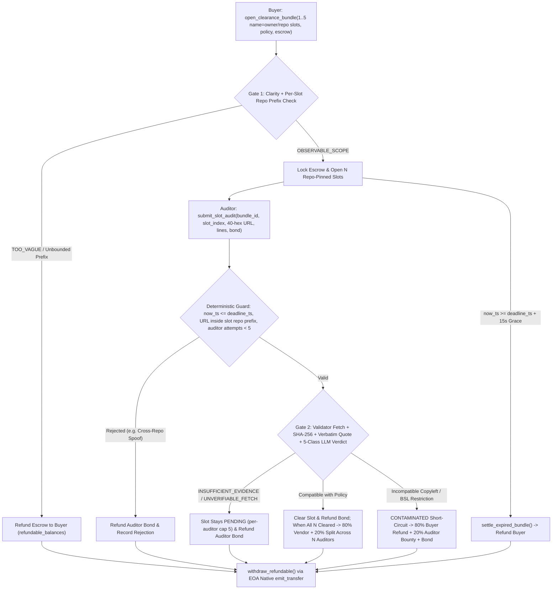

# License Fence — 5-Class SPDX Lattice & Per-Slot Repo-Pinned Copyleft Escrow

**License Fence** is a GenLayer Intelligent Contract (`contracts/license_fence.py`) and StudioNet compliance console (`frontend/`) that enforces open-source license compatibility across multi-dependency software releases—including real repositories where automated SPDX detectors (`licensee` / GitHub) return `NOASSERTION`.

Buyers lock GEN escrow across `1..5` dependency slots, binding **each slot to its exact GitHub `<owner>/<repo>/` prefix** under a deterministic compliance policy (`PERMISSIVE_ONLY`, `PROPRIETARY_COMMERCIAL`, or `SAAS_CLOUD_SERVICE`). Auditors submit 40-hex commit-pinned `LICENSE`/`NOTICE` excerpts. GenLayer validators read the prose via Optimistic Democracy (distinguishing default LGPL builds with optional GPL modules, identifying BSL 1.1 non-compete clauses, ignoring prompt-injection payloads, and verifying verbatim quotes `>= 12` chars), while plain Python handles every payout, short-circuit, retry refund, and grace-enforced expiry.

---

## Architecture



---

## Live StudioNet Deployment (v2)

- **Network:** GenLayer StudioNet (`Chain ID 61999`, RPC `https://studio.genlayer.com/api`)
- **LicenseFence Contract:** [`0x4F6043DEb29CC2F2D7770A0cfF5FE67525dFA593`](https://explorer-studio.genlayer.com/address/0x4F6043DEb29CC2F2D7770A0cfF5FE67525dFA593)
- **Deploy Tx:** [`0x29c3bb26...`](https://explorer-studio.genlayer.com/tx/0x29c3bb2655e09b477704f86aadd40f898ba3a04109b79a0e6b128cdbcc0a46bd)
- **Contract Source SHA-256:** `1871f7da7f69605648fb346a0a593228d9f4655694367033b7d85dc639519cab`

### Finalized 8-Case / 19-Tx StudioNet Proof Bundle (`deploy/proof.json`)

| Exhibit | Case | Live Validator Verdict : Reason Code | Bundle Status | StudioNet Tx |
| :--- | :--- | :--- | :--- | :--- |
| `LF-01` | Gate-1 TOO_VAGUE Scope Rejection & Buyer Refund | `TOO_VAGUE : SUBJECTIVE_OR_UNMEASURABLE` | `REJECTED` | [`0xc4f808b0...`](https://explorer-studio.genlayer.com/tx/0xc4f808b0c15b2acef74788e1681c32e559a2142dfdebbe8b87087a108d70871d) |
| `LF-02` | Multi-Slot Clearance Step 1: Apache-2.0 (`psf/requests`, Bundle #1 Slot 0) | `PERMISSIVE : APACHE_2_GRANT` | `CLEARED_FOR_RELEASE` | [`0x146e66b0...`](https://explorer-studio.genlayer.com/tx/0x146e66b0975ecfb7f95e93467d7b71d0c82113b2abe2dcfe564db35acd263b42) |
| `LF-03` | Semantic `NOASSERTION` Clearance: FFmpeg LGPL v2.1+ Default (`FFmpeg/FFmpeg`, Bundle #1 Slot 1 -> 80/20 Release) | `WEAK_COPYLEFT : LGPL_OR_MPL_FILE_SCOPE` | `CLEARED_FOR_RELEASE` | [`0x15dd7cd7...`](https://explorer-studio.genlayer.com/tx/0x15dd7cd76a558c025d9bd53e425dd3073703ead98ed43e026f3ad4ce6662bad9) |
| `LF-04` | Semantic `NOASSERTION` Contamination: HashiCorp Consul BSL 1.1 (`hashicorp/consul`, Bundle #2 Slot 0) | `SOURCE_AVAILABLE_RESTRICTED : BSL_OR_NON_COMPETE_RESTRICTION` | `CONTAMINATED` | [`0xb328d5be...`](https://explorer-studio.genlayer.com/tx/0xb328d5be7885cc308b5880f3729151541f57db33a664b54da81ee97348487e31) |
| `LF-05` | Network-Copyleft Contamination Short-Circuit: Grafana AGPL-3.0 (`grafana/grafana`, Bundle #3 Slot 0) | `NETWORK_COPYLEFT : AGPL_NETWORK_INTERACTION_CLAUSE` | `CONTAMINATED` | [`0xed2a1361...`](https://explorer-studio.genlayer.com/tx/0xed2a1361565d5e85cf59ae27b5143b139b489b860e0ca44ea21769f0dcf9a2c1) |
| `LF-06` | Cross-Repo Spoof Blocked (`0x2b0e9098...`) + Unrelated `.gitignore` Refund (Bundle #4 Slot 0) | `INSUFFICIENT_EVIDENCE : UNRELATED_FILE_OR_SLICE` | `OPEN` | [`0xd34360a2...`](https://explorer-studio.genlayer.com/tx/0xd34360a2f78a5f41eed7647a2970a1812a6f77a375d81fa45a311ef23757f327) |
| `LF-07` | Adversarial Prompt Injection Ignored (`protectai/rebuff`, Bundle #4 Slot 1) | `INSUFFICIENT_EVIDENCE : UNRELATED_FILE_OR_SLICE` | `OPEN` | [`0xbad37f7d...`](https://explorer-studio.genlayer.com/tx/0xbad37f7d0baf1e2f152676e7d57286bd89a5d4f62fb4e113d900cbd1bf394eb4) |
| `LF-08` | Enforced 15s Grace Expiry (`EXPIRY_GRACE_SECONDS = 15`) & 4-EOA Native Withdrawals (Bundle #5) | `EXPIRED_REFUNDED : BUNDLE_DEADLINE_PLUS_GRACE_EXPIRED` | `EXPIRED_REFUNDED` | [`0x1881f79e...`](https://explorer-studio.genlayer.com/tx/0x1881f79e560bc69828e0dcc380ee1041cac54bd2c7aca9862ee10e34c44a3f01) |

---

## Quickstart & Verification

```bash
# 1. Run deterministic contract unit tests (10 tests)
pytest tests/test_license_fence.py -v

# 2. Verify all 19 finalized StudioNet txs, source SHA-256, and zero post-withdrawal balances
python deploy/verify_proof.py

# 3. Run frontend tests & production build
npm --prefix frontend install
npm --prefix frontend run test
npm --prefix frontend run build
```

---

## Honest Limitations

- **Single-slice scope (`<= 120` lines / `<= 3000` normalized chars):** Each audit evaluates one commit-pinned file slice per slot rather than crawling transitive lockfiles (`package-lock.json` / `Cargo.lock`) automatically. Transitive dependency discovery happens off-chain; License Fence anchors and settles the disputed slots on-chain.
- **GitHub raw availability:** Evidence URLs are restricted to 40-hex commit-pinned `raw.githubusercontent.com/<owner>/<repo>/` URLs. If a repository is deleted or made private, validators return `UNVERIFIABLE_FETCH` (refunding the auditor's bond without slashing).
- **Non-slashing retry trade-off:** `INSUFFICIENT_EVIDENCE` refunds the auditor's bond so honest researchers aren't penalized for ambiguous slices; per-auditor retry caps (`MAX_AUDITOR_ATTEMPTS_PER_SLOT = 5`) prevent any single spammer from bricking a slot, though Sybil accounts can still pay StudioNet transaction fees to submit noise until an honest auditor clears the slot.
- **Legal disclaimer:** On-chain verdicts automate bilateral software-delivery escrow settlement according to the declared policy lattice; they are not formal legal counsel.

See [docs/TUTORIAL.md](docs/TUTORIAL.md) (750+ words with real contract code) and [docs/DEMO_SCRIPT.md](docs/DEMO_SCRIPT.md) for the full walkthrough.
