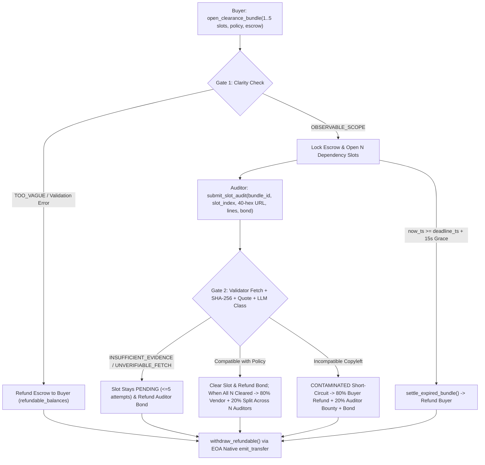

# License Fence — SPDX Compatibility Lattice & Multi-Slot Copyleft-Contamination Escrow

**License Fence** is a GenLayer Intelligent Contract (`contracts/license_fence.py`) and StudioNet web application (`frontend/`) that enforces open-source license compliance across multi-dependency software releases.

Buyers lock GEN escrow across `1..5` dependency slots under a deterministic **SPDX Compatibility Policy** (`PERMISSIVE_ONLY`, `PROPRIETARY_COMMERCIAL`, or `SAAS_CLOUD_SERVICE`). Independent auditors submit 40-hex commit-pinned `LICENSE`/`NOTICE` excerpts from `raw.githubusercontent.com`. GenLayer validators classify the actual license text via Optimistic Democracy (ignoring prompt-injection payloads and verifying verbatim quotes `>= 12` chars), while deterministic Python settles multi-auditor payouts, copyleft contamination short-circuits, non-slashing retries, and grace-enforced expiries.

---

## Architecture



---

## Live StudioNet Deployment

- **Network:** GenLayer StudioNet (`Chain ID 61999`, RPC `https://studio.genlayer.com/api`)
- **LicenseFence Contract:** [`0x734EFFB86dC0F198B145df03960A578B2Ef15343`](https://explorer-studio.genlayer.com/address/0x734EFFB86dC0F198B145df03960A578B2Ef15343)
- **Deploy Tx:** [`0xcb0ab72b...`](https://explorer-studio.genlayer.com/tx/0xcb0ab72ba05eb69c3b7c245a6fb10dc37c2fde1fc317b22441f0c35ed1425bb5)
- **Contract Source SHA-256:** `fbe29c41b1b8b59e1d8c26ea498edc1916fedd845a7a8e1cd908c36a52477313`

### Finalized 7-Case StudioNet Proof Bundle (`deploy/proof.json`)

| Exhibit | Case | Verdict : Reason Code | StudioNet Tx |
| :--- | :--- | :--- | :--- |
| `LF-01` | Gate-1 TOO_VAGUE Scope Rejection & Buyer Refund | `TOO_VAGUE : SUBJECTIVE_OR_UNMEASURABLE` | [`0xc93ecc53...`](https://explorer-studio.genlayer.com/tx/0xc93ecc531716185d2826796da1f8434ab832d91c7824522242d5093af5e035d2) |
| `LF-02` | Multi-Slot Clearance Step 1: Apache-2.0 (`psf/requests`, Bundle #1 Slot 0) | `PERMISSIVE : APACHE_2_GRANT` | [`0xb7efc249...`](https://explorer-studio.genlayer.com/tx/0xb7efc249f86c3930182d34176c3f2ab40e0cfb4a17a9c298af881df38d906382) |
| `LF-03` | Multi-Slot Clearance Complete: BSD-3-Clause (`pallets/flask`, Bundle #1 Slot 1) -> 80/20 Release | `PERMISSIVE : MIT_OR_BSD_GRANT` | [`0xdb225990...`](https://explorer-studio.genlayer.com/tx/0xdb2259906c349336dfacb4ae724c71f299216fe53a22bae7ba7c20b543c445c9) |
| `LF-04` | Copyleft Contamination Short-Circuit: AGPL-3.0 (`grafana/grafana`, Bundle #2 Slot 0) | `NETWORK_COPYLEFT : AGPL_NETWORK_INTERACTION_CLAUSE` | [`0xd0929567...`](https://explorer-studio.genlayer.com/tx/0xd0929567187c18497fc42038aab1ffd453f9c53e8efd0257a2f0f3332982fa93) |
| `LF-05` | Retryable Non-Slashing: Unrelated `.gitignore` File (Bundle #3, Attempt 1) | `INSUFFICIENT_EVIDENCE : UNRELATED_FILE_OR_SLICE` | [`0x306984c5...`](https://explorer-studio.genlayer.com/tx/0x306984c5e7abf194a8b45a6427403dbf5218fb2b46836dbbcb7ddf1bab590f67) |
| `LF-06` | Adversarial Prompt Injection Ignored (`protectai/rebuff`, Bundle #3, Attempt 2) | `INSUFFICIENT_EVIDENCE : ADVERSARIAL_INJECTION_IGNORED` | [`0xaea2258a...`](https://explorer-studio.genlayer.com/tx/0xaea2258a36e7071120c7fdd3a8c12e688de07164a5d7d486870bf6aad435981d) |
| `LF-07` | Enforced 15s Grace Expiry (`EXPIRY_GRACE_SECONDS = 15`) & 4-EOA Withdrawals (Bundle #4) | `EXPIRED_REFUNDED : BUNDLE_DEADLINE_PLUS_GRACE_EXPIRED` | [`0x90716245...`](https://explorer-studio.genlayer.com/tx/0x9071624570419db0e9e671697192d54408ad0282344e5116f99239f915df4b08) |

---

## Quickstart & Verification

```bash
# Contract unit tests
pytest tests/test_license_fence.py -v

# Read-only StudioNet proof verification (all 16 txs + live contract state)
python deploy/verify_proof.py

# Frontend tests & production build
npm --prefix frontend install
npm --prefix frontend run test
npm --prefix frontend run build
```

See [docs/TUTORIAL.md](docs/TUTORIAL.md) and [docs/DEMO_SCRIPT.md](docs/DEMO_SCRIPT.md) for the full walkthrough.
